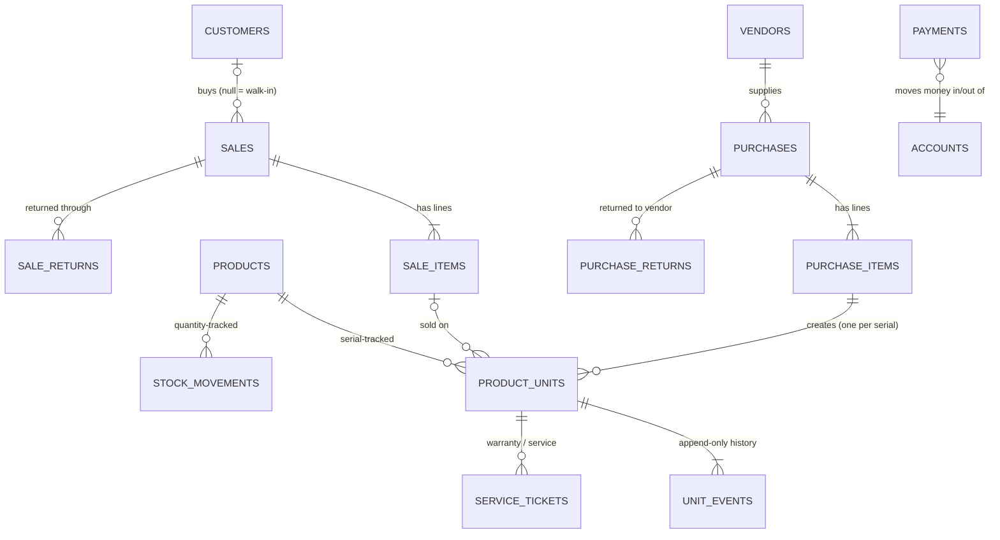
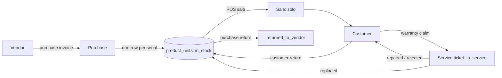

# Architecture

How ssERP is put together, for contributors. For *using* ssERP see the [README](../README.md) and the
[wiki sources](wiki/Home.md). The rules every change must keep are in
[CONTRIBUTING.md](../CONTRIBUTING.md#invariants-every-change-must-keep).

## Layers

```
Browser (React 19 client components: forms, POS, scanner, tables)
   |  server actions / route handlers / server-rendered pages
src/app/            Next.js App Router: (admin) pages, (print) print views, auth, install, api/health
   |  calls only src/server (never the database directly)
src/server/actions/ authorization + branch scope: guarded(permission) / guardedBranch(permission)
   |
src/server/<module> business logic and data access (no UI): purchases, sales, serials, inventory, lookup,
                    service, accounting, reports, parties, catalog, iam, branches, labels, demo
   |
src/server/db/      Drizzle ORM schema + one getDb() over two drivers (Neon serverless / node-postgres)
   |
PostgreSQL          migrations in drizzle/ (append-only)
```

- **`src/proxy.ts`** (the Next.js 16 proxy, formerly middleware) only verifies the session cookie's signature and
  expiry. It never touches the database. Public paths are an exact allow-list in `src/server/auth/public-paths.ts`.
- **Sessions** are signed tokens (`jose`) in an HTTP-only cookie, valid for 7 days. Revocation (disabled user, bumped
  `session_version`) is checked on the server in `getSession()` on every request that reads the session.
- **Authorization** happens in `src/server/actions/guard.ts`: `guarded(permission, fn)` authorizes first, then runs
  `fn` with the session; `guardedBranch` also resolves the branch scope on the server. The company id and branch id
  always come from the session, never from the client.
- **Permissions** are a pure catalog in `src/server/rbac.ts` (`module.action` keys plus `activity.view` and
  `branches.all`). The system admin flag passes every check.

## Data model overview

Every business table carries `company_id` (the schema is multi-company ready; the UI runs one company per install)
and branch-owned tables carry `branch_id`. The core of the model is the life of one serial unit:



Lifecycle of a unit (statuses from `src/server/serials.ts`):



Main table groups (see `src/server/db/schema/`):

| Group | Tables |
| --- | --- |
| Identity | `companies`, `branches`, `settings`, `users`, `roles`, `role_permissions`, `login_attempts`, `doc_sequences` |
| Parties | `vendors`, `customers` |
| Catalog and stock | `categories`, `brands`, `products`, `product_units`, `unit_events`, `stock_movements`, `stock_adjustments`, `stock_transfers`, `stock_transfer_items` |
| Purchasing | `purchases`, `purchase_items`, `purchase_returns`, `purchase_return_items` |
| Sales | `sales`, `sale_items`, `sale_returns`, `sale_return_items` |
| Service | `service_tickets` |
| Money | `accounts`, `payments` (the single source of truth for money movement), `expenses`, `expense_categories`, `incomes` |
| Audit | `activity_log`, `record_history` |

Serial-tracked products keep one `product_units` row per physical unit; quantity-tracked products keep a ledger in
`stock_movements` (on-hand = sum of `qty_change`).

## Integrity invariants

- **Tenancy.** Every query filters by the session's `company_id`, including every join (database tests such as
  `src/server/tenant-joins.db.test.ts` check that a cross-company reference never leaks another company's rows). Branch-owned reads take an explicit
  `BranchFilter`, writes a `WriteCtx` (`src/server/branch.ts`); `src/server/branch-scope-registry.test.ts`
  classifies every exported data-layer function.
- **Lock order.** Writes that touch units or stock take locks in one global order so concurrent requests cannot
  deadlock or sell a serial twice: the write branch row `FOR SHARE` -> the parent document row `FOR UPDATE` (payments,
  returns) -> product rows `FOR SHARE` (serial) or `FOR UPDATE` (quantity), sorted by id -> the document number row
  -> unit rows `FOR UPDATE`, sorted by id.
- **State machine.** `product_units.status` changes only through `src/server/serials.ts` (`TRANSITIONS`), and each
  change appends exactly one `unit_events` row in the same transaction.
- **Exact money.** `numeric(14,2)` in the database, integer minor units in code (`src/server/money.ts`). The server
  recomputes every total; the client's `expectedTotal` must match or the save is rejected.
- **One transaction per business operation**, including its stock change, payments, activity log and history.
- **Idempotency.** Sales, purchases, adjustments and transfers accept a client key; a resubmitted key with the same
  payload returns the first result instead of writing twice.

## Request flow (example: a POS sale)

1. The browser posts the sale form to a server action in `src/server/actions/sales.ts`.
2. `guardedBranch('sales.create', ...)` loads the session, checks the permission and resolves the active branch.
3. `createSale()` in `src/server/sales/sales.ts` opens one transaction: branch `FOR SHARE`, products, the invoice
   number, units `FOR UPDATE`; it re-checks every unit is `in_stock` in that branch, recomputes the totals, writes the
   sale, lines, unit transitions (`sold` + warranty dates), stock movements, payments, activity log and history.
4. Expected failures (a serial already sold, a total mismatch) come back as friendly field errors; unexpected errors are
   logged through `safeLog` (error class and Postgres code only) and replaced by a generic message.

## Directory map

| Path | Contents |
| --- | --- |
| `src/app/` | Routes. `(admin)` pages, `(print)` A4 / 80 mm / label views, `auth/login`, `install`, `api/health` |
| `src/server/` | All business logic and data access (no React) |
| `src/server/db/` | Drivers (`neon` / `pg`), schema, `rowsOf()` |
| `src/components/`, `src/layouts/` | UI shell, navigation, shared components |
| `src/assets/` | Sass layer on Bootstrap 5 (`scss/_tokens.scss`), self-hosted fonts, bundled icons |
| `drizzle/` | Committed SQL migrations and journal |
| `scripts/` | `setup`, `migrate`, `admin-reset`, `seed-demo`, test runners, docs and repository tooling |
| `e2e/` | Playwright smoke test and README screenshot capture |
| `docs/` | Specs, database notes, roadmap, maintainer docs, wiki sources |

## Testing strategy

| Layer | Command | What it covers |
| --- | --- | --- |
| Unit | `npm test` (Vitest) | Pure logic: money, totals, permissions, CSV parsing, report maths, registries; no database |
| Database | `npm run test:db` | `*.db.test.ts` against a throwaway local PostgreSQL started by `scripts/test-db.sh`: locking, concurrency races, tenancy, branch isolation, migrations |
| End to end | `npm run test:e2e` | Playwright on a production build: install, purchase, scan-sell, lookup, return, reports, transfer, sign-out; axe accessibility, security headers, clean console, 375 px layout |
| Static | `npm run lint`, `npx tsc --noEmit`, `npm run check:theme`, `npm run check:docs` | Lint, types, licence guard, documentation links |

Automated tests run on plain PostgreSQL. The Neon driver path is the same Drizzle code over Neon's pool but is not
exercised by automated tests (see [DATABASE.md](DATABASE.md)).
