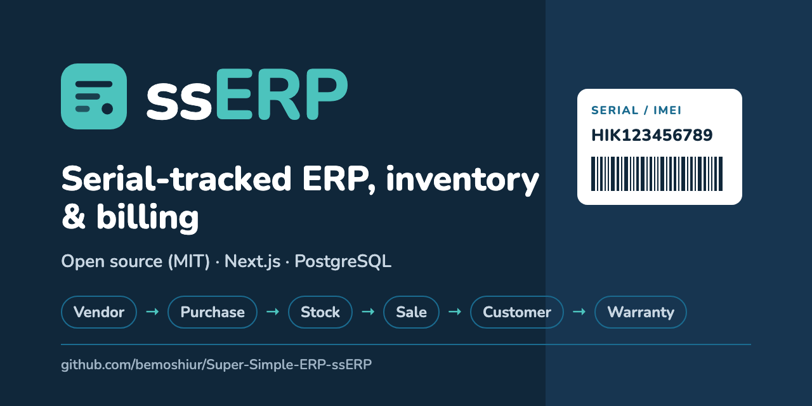

# Social preview image

GitHub shows a repository's **social preview** image when a link to it is shared (chat apps, social networks, search
results). ssERP's image is [social-preview.png](social-preview.png).



## Requirements

| Requirement | Value |
| --- | --- |
| Size | 1280 x 640 pixels (GitHub's recommendation; minimum 640 x 320) |
| File | PNG, at most 300 KB here (GitHub accepts up to 1 MB) |
| Safe area | Keep text and the logo at least 80 px from every edge: some sites crop the image to a square or a narrower ratio |
| Content | ssERP's own mark and wordmark, the tagline "Serial-tracked ERP, inventory & billing", no third-party logos, photos or fonts other than the self-hosted Nunito that ships with the app |
| Colours | The app palette from `src/assets/scss/_tokens.scss`: ink `#10273a`, brand `#1b6b8f`, accent `#4cc3bd`, text on ink `#c8d6e2` |
| Contrast | Text at least 4.5:1 against its background |

## Regenerating it

The image is rendered from an HTML template by Playwright's Chromium (already a dev dependency), so it is reproducible
and needs no design tool:

```bash
npx playwright install chromium    # once
node scripts/make-social-preview.mjs
```

The script writes `docs/social-preview.png`, prints its size, and fails if the file is larger than 300 KB. It uses no
network: the fonts are read from `src/assets/fonts/`. The same Chromium version produces the same pixels; a different
version may change anti-aliasing slightly.

## Uploading it

GitHub does not read the image from the repository. A maintainer uploads it once (and after every change):
**Settings > General > Social preview > Edit > Upload an image**, choose `docs/social-preview.png`, save.
