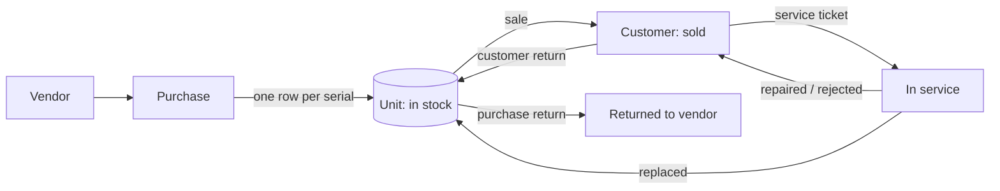

# Architecture Overview

A short tour for people who want to read or change the code. The full version, with the data model diagram, is
[docs/ARCHITECTURE.md](https://github.com/bemoshiur/Super-Simple-ERP-ssERP/blob/main/docs/ARCHITECTURE.md) in the
repository.

## Stack

| Layer | Technology |
| --- | --- |
| Web framework | Next.js 16 (App Router, server actions), React 19 |
| UI | Bootstrap 5 with ssERP's own Sass layer, React-Bootstrap, TanStack Table, Chart.js |
| Data access | Drizzle ORM |
| Database | PostgreSQL; Neon serverless driver or node-postgres |
| Auth | Signed session cookies (`jose`), bcrypt passwords |
| Validation | Zod |
| Tests | Vitest (unit and database), Playwright with axe-core (end to end) |

## Layers

```
Browser  ->  src/app (pages, server actions, route handlers)
         ->  src/server/actions (authorize + branch scope)
         ->  src/server/<module> (business logic, data access; no UI)
         ->  src/server/db (Drizzle schema, Neon / pg drivers)
         ->  PostgreSQL (migrations in drizzle/)
```

- `src/proxy.ts` (Next.js proxy) checks only the session signature; it never touches the database.
- `guarded(permission, fn)` and `guardedBranch(permission, fn)` in `src/server/actions/guard.ts` authorize before
  any work, take the company and branch from the session, and turn expected failures into friendly messages.
- `src/server/rbac.ts` is the pure permission catalog.

## The unit lifecycle



Serial-tracked products have one `product_units` row per physical unit with an append-only `unit_events` history.
Quantity products use a `stock_movements` ledger. Money moves only through the `payments` table.

## Invariants (the rules reviewers check)

1. **Company scoping** on every query and join.
2. **Authorize first** in every server action and route handler.
3. **Exact money**: integer minor units, `numeric(14,2)` storage, server-side totals.
4. **Lock order**: branch row `FOR SHARE` -> parent document `FOR UPDATE` -> products (`FOR SHARE` serial,
   `FOR UPDATE` quantity, by id) -> document number -> units `FOR UPDATE` (by id).
5. **Unit status** changes only through the state machine in `src/server/serials.ts`.
6. **Append-only migrations**.
7. **History** (activity log, record history) in the same transaction.
8. **No secrets** in logs or responses.
9. **Tests** for every change; database tests for locking, money and serial state.
10. **Public paths** are an exact allow-list.
11. **Branch scope** through `BranchFilter` / `WriteCtx`, classified in the branch-scope registry test.

Plus the **cost visibility** rule: cost fields are omitted on the server for users without profit visibility.
Details: [CONTRIBUTING.md](https://github.com/bemoshiur/Super-Simple-ERP-ssERP/blob/main/CONTRIBUTING.md#invariants-every-change-must-keep).

## Repository map

| Path | What |
| --- | --- |
| `src/app/` | Routes: `(admin)` pages, `(print)` views, `auth`, `install`, `api/health` |
| `src/server/` | Business logic per module (`purchases`, `sales`, `inventory`, `lookup`, `service`, `accounting`, `reports`, ...) |
| `src/server/db/schema/` | Table definitions |
| `src/components/`, `src/layouts/` | UI shell and shared components |
| `drizzle/` | SQL migrations (18 in v0.1.0) |
| `scripts/` | Installer, migration runner, admin reset, demo seed, test runners, repository tooling |
| `e2e/` | Playwright tests |
| `docs/` | Architecture, database, roadmap, maintainer docs, these wiki sources |

## Tests

| Command | Runs |
| --- | --- |
| `npm test` | Unit tests, no database |
| `npm run test:db` | `*.db.test.ts` on a throwaway local PostgreSQL (needs `initdb` / `pg_ctl`) |
| `npm run test:e2e` | Playwright smoke test on a production build with a throwaway PostgreSQL |

CI runs these plus lint, typecheck, the licence guard and the docs link check. Automated tests use plain PostgreSQL;
the Neon driver path is not covered by automated tests.

Next: [Database and Migrations](Database-and-Migrations), [Contributing Guide](Contributing-Guide).

Last verified against v0.1.0.
