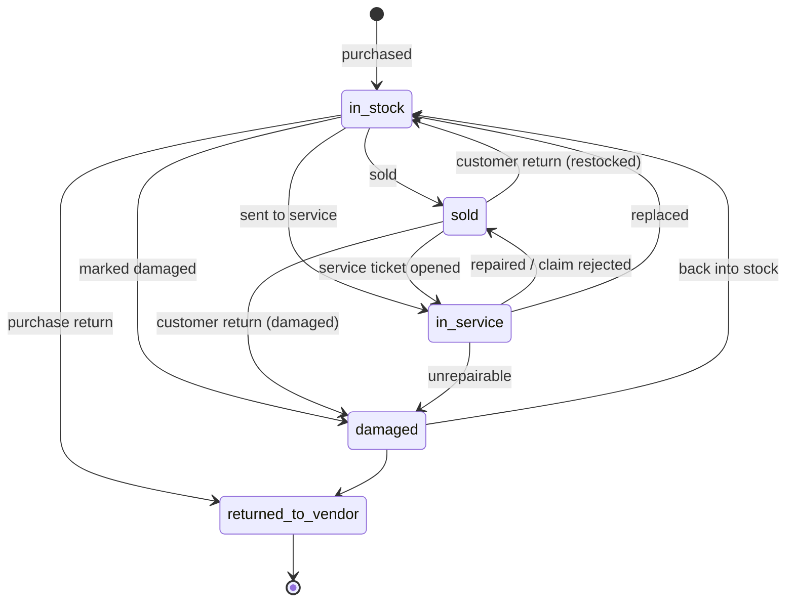

# Serial Tracking Guide

Every physical unit of a serial-tracked product is one record (a `product_units` row) with its own serial number or
IMEI, status, branch, cost, warranty and history.

## Serial numbers

- A serial is **unique per company**. The same serial cannot be bought twice.
- Up to 64 characters. Bengali and other scripts are allowed.
- Lookup is exact first, then case-insensitive, then partial (see below).

## Statuses

| Status | Meaning |
| --- | --- |
| **In stock** | In a branch, available to sell |
| **Sold** | With a customer; has warranty start and end dates |
| **In service** | Under an open service ticket |
| **Damaged** | Written off (damage or loss), or returned damaged |
| **Returned to vendor** | Sent back on a purchase return. Final. |

There is no separate "lost" status: a lost unit is marked **damaged** with the reason "loss" in its history.

## State machine

Status changes happen only along these arrows, and every change writes one history event in the same transaction:

The diagram is what the state machine (`src/server/serials.ts`) allows. The v0.1.0 screens use only part of it:

- service tickets are opened only for **sold** units (no in stock -> in service from the UI),
- purchase returns accept only **in-stock** units, so a damaged unit cannot be sent back to the vendor yet (no vendor
  RMA flow),
- no screen moves a **damaged** unit back into stock or to the vendor,
- stock adjustments only take a unit **in stock -> damaged**.

A branch transfer changes a unit's branch but not its status (event `transferred`).

## History events

`purchased`, `sold`, `sale_returned`, `returned_to_vendor`, `sent_to_service`, `returned_from_service`,
`marked_damaged`, `status_changed`, `note`, `transferred`. Events are append-only: nothing edits or deletes them.

## Serial Lookup

**Serial Lookup** (`/serials`) takes a typed or scanned serial:

1. exact match (case-sensitive),
2. otherwise a case-insensitive exact match,
3. otherwise a partial match (up to 20 results).

A single hit opens the unit page directly. The unit page shows the product, status, branch, the vendor and purchase
invoice, the customer and sale invoice, warranty start, end and days left, open service tickets and the timeline.

- **Purchase cost and profit** are shown only to users with profit visibility (`reports.view` or `sales.edit`).
- A user restricted to one branch sees only serial, status and branch of a unit located in another branch.

## Warranty

- Each unit carries warranty months, copied from the product at purchase (or from the `warranty_months` column of a
  CSV import, up to 120).
- On sale, warranty start = the sale date, warranty end = start + months (no warranty when months is 0).
- **Reports > Warranty expiry** lists sold units whose warranty ends in the next 30, 60 or 90 days.
- A customer return that puts the unit back in stock clears its sale link and warranty dates (so it can be sold
  again with a fresh warranty).

## Returns

- **Customer return** (from the sale invoice): choose the units and whether each goes back **in stock** or is
  **damaged**. A refund beyond what the customer still owes on that invoice is paid out. See
  [Sales and POS](Sales-and-POS).
- **Purchase return** (from the purchase invoice): only units of that purchase that are **in stock**. The credit first
  reduces the invoice due; any excess can be taken as a cash refund now or left as vendor credit. See
  [Purchases and Bulk Import](Purchases-and-Bulk-Import).

## Service tickets

Open a ticket from the unit page or Serial Lookup (permission `serials.create`) for a **sold** unit. The ticket gets
a number (`SVC-00001`), records whether the unit was under warranty on the opening date, and moves the unit to
**in service**. A unit can have only one active ticket.

Tickets are **open** or **in progress** while active. Finish one with an outcome (`serials.edit`):

| Outcome | Ticket becomes | Unit becomes |
| --- | --- | --- |
| Repaired: back to the customer | resolved | sold (warranty unchanged) |
| Claim rejected: returned as is | rejected | sold |
| Replaced: unit returns to inventory | closed | in stock (sale link and warranty cleared) |
| Unrepairable: mark damaged | closed | damaged |

The **Service** page lists tickets. In a multi-branch company a ticket belongs to the branch that took the unit in,
and opening it moves the unit to that branch.

## Integrity guarantees

- Two cashiers scanning the same serial at the same moment cannot both sell it: the unit row is locked and the second
  sale is told it is already sold.
- A unit can be sold, adjusted or returned to the vendor only from the branch it is in.

Last verified against v0.1.0.
